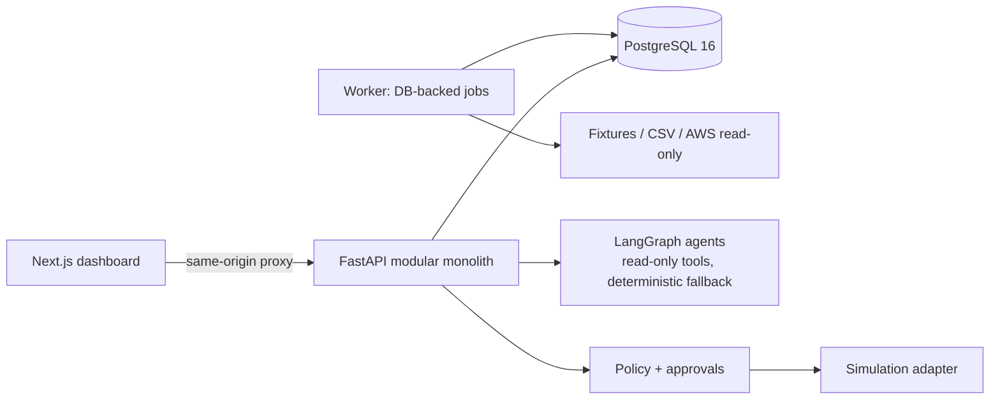

# Nimbrix

**Autonomous cloud cost intelligence and optimization.** Nimbrix ingests cloud cost and
resource data, explains where money goes, detects anomalies and waste, forecasts spend,
produces evidence-backed recommendations, simulates savings, and runs a small allowlist
of safe actions **only after explicit human approval**.

> **Project status: Phase 0 — engineering foundation.** What runs today is the platform
> skeleton: FastAPI API with health/readiness/metrics, PostgreSQL with the first
> migration, a Next.js status page, Docker Compose, tests, and CI. Cost ingestion,
> analytics, ML, agents, and approvals are designed but **not implemented yet**; see
> [docs/PROGRESS.md](docs/PROGRESS.md) for exact status.

Local-first by design: no cloud account, credentials, or paid LLM key is needed, and
remediation is **simulation-only**.

## What works now (Phase 0)

- `GET /api/v1/health/live`, `GET /api/v1/health/ready` (checks PostgreSQL connectivity
  and that the schema is at the latest Alembic revision), `GET /api/v1/metrics` (Prometheus)
- Validated configuration that fails fast without leaking secret values
- Structured JSON logs with secret redaction and request correlation IDs
- Stable error envelope for every failure
- Next.js status page that polls readiness through a same-origin proxy
- Typed API contracts: OpenAPI exported from code → generated TypeScript types
- Unit, integration (real PostgreSQL 16), component, and Playwright E2E tests; GitHub Actions CI

## Architecture



Details: [architecture](docs/architecture.md) · [ADRs](docs/adr/README.md) ·
[API](docs/api.md) · [security](docs/security.md).

## Tech stack

| Layer | Choice |
| --- | --- |
| Frontend | Next.js 16, React 19, TypeScript, Tailwind CSS 4, TanStack Query |
| Backend | Python 3.12, FastAPI, Pydantic v2, SQLAlchemy 2, Alembic, psycopg 3 |
| Data | PostgreSQL 16 |
| Quality | Ruff, mypy (strict), pytest, ESLint, Prettier, Vitest, Playwright |
| Ops | Docker Compose, GitHub Actions, Prometheus metrics |

## Prerequisites

| Tool | Version used for verification |
| --- | --- |
| Docker (with Compose v2) | 29.x |
| Node.js | 22+ (CI uses 24; verified locally on 25) |
| uv | 0.10+ (installs Python 3.12 automatically) |
| GNU Make | any |

Docker alone is enough to run the stack; Node and uv are needed for development and tests.

## Quickstart

```bash
cp .env.example .env        # set POSTGRES_PASSWORD to any local value
make up                     # build + start postgres, migrations, api, web (waits for health)
```

| Service | URL |
| --- | --- |
| Web (status page) | http://127.0.0.1:3200 |
| API readiness | http://127.0.0.1:8200/api/v1/health/ready |
| API docs (OpenAPI UI) | http://127.0.0.1:8200/api/v1/docs |
| PostgreSQL | `127.0.0.1:5440` |

Ports are configurable in `.env`. All bindings are `127.0.0.1` only.

Stop with `make down`; `make reset-db` also deletes the local database volume.

## Development

```bash
make install             # uv sync + npm ci
make db                  # just PostgreSQL
make migrate             # alembic upgrade head
make api-dev             # API with reload on :8200
make web-dev             # Next.js dev server on :3200
```

## Tests and checks

```bash
make lint                # ruff, ruff format --check, eslint, prettier --check
make typecheck           # mypy --strict, tsc
make test-api            # API unit tests
make test-integration    # API + migrations against real PostgreSQL (make db first)
make test-web            # Vitest component/unit tests
make e2e                 # Playwright against the running stack (make up first)
make contracts           # regenerate OpenAPI + TypeScript types after API changes
make check               # everything CI runs except Docker/E2E
```

## Roadmap

| Phase | Scope | Status |
| --- | --- | --- |
| 0 | Discovery, design, engineering foundation | ✅ Complete |
| 1 | Data model, API foundation, authentication, tenancy | Not started |
| 2 | Synthetic data and AWS cost/inventory ingestion | Not started |
| 3 | Cost analytics, budgets, optimization rules | Not started |
| 4 | ML forecasting and anomaly detection | Not started |
| 5 | LangGraph investigation agents | Not started |
| 6 | Approvals, policy engine, safe remediation | Not started |
| 7 | Full dashboard | Not started |
| 8 | Security, observability, reliability hardening | Not started |
| 9 | Deployment docs, benchmarks, release | Not started |

## Known limitations

See [docs/PROGRESS.md](docs/PROGRESS.md#known-limitations) — kept current every phase.
