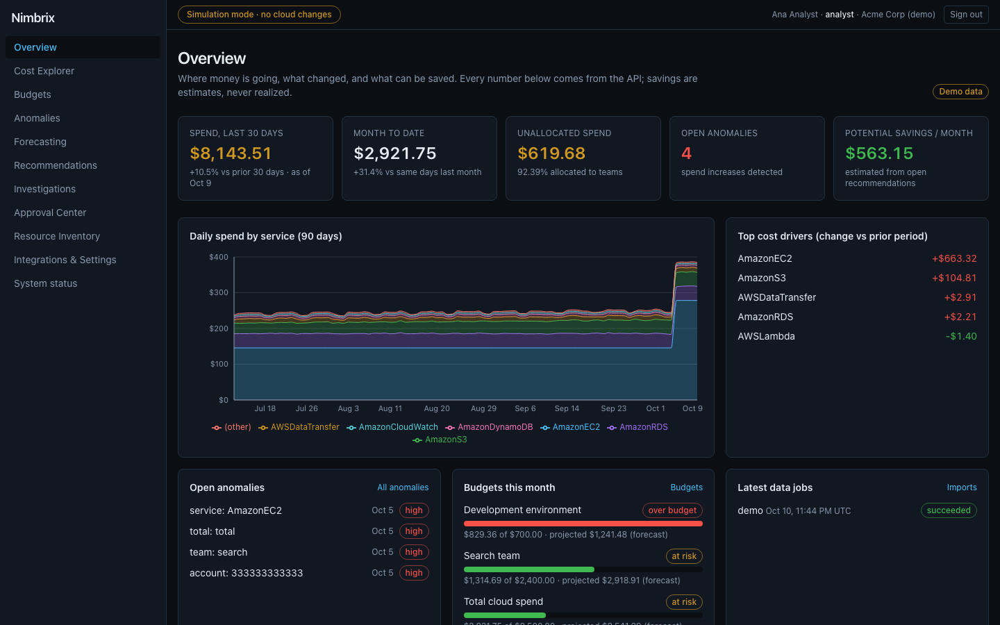
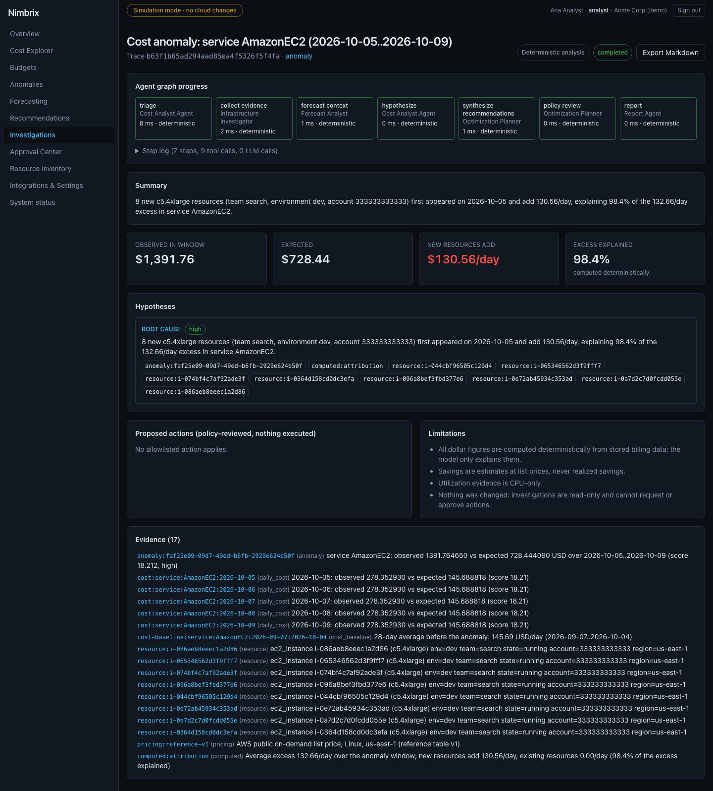
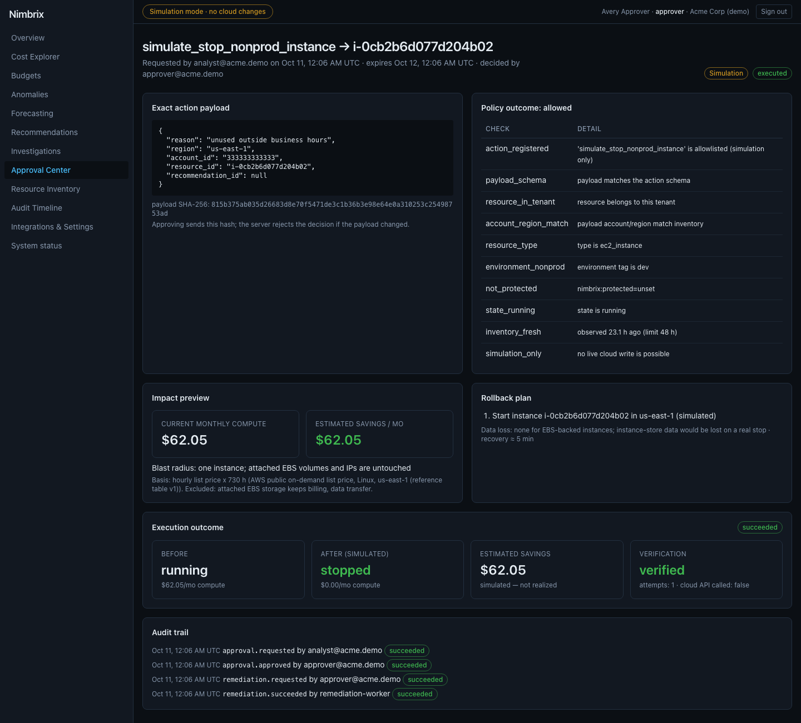
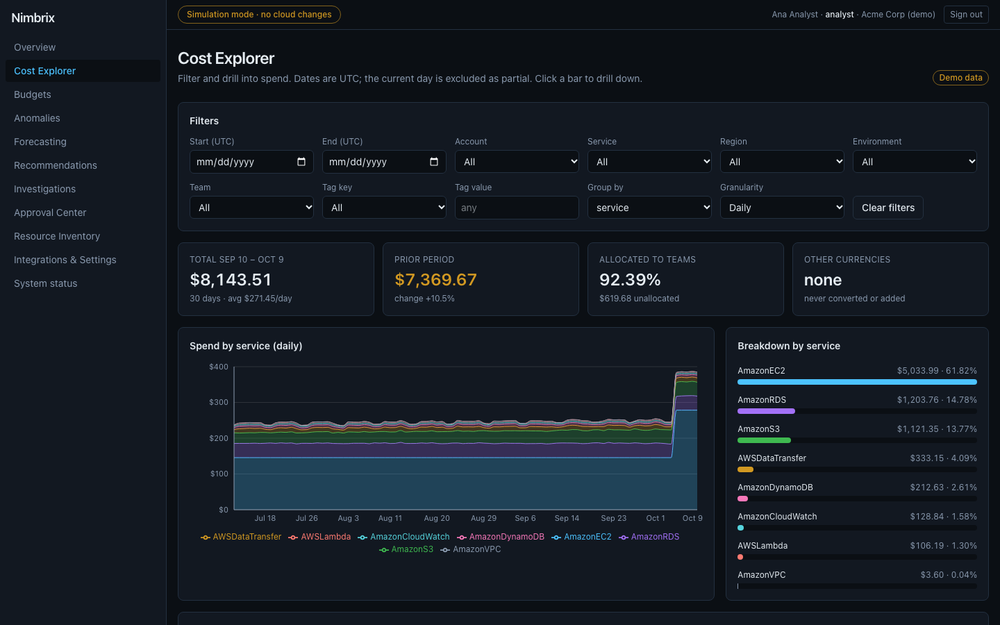
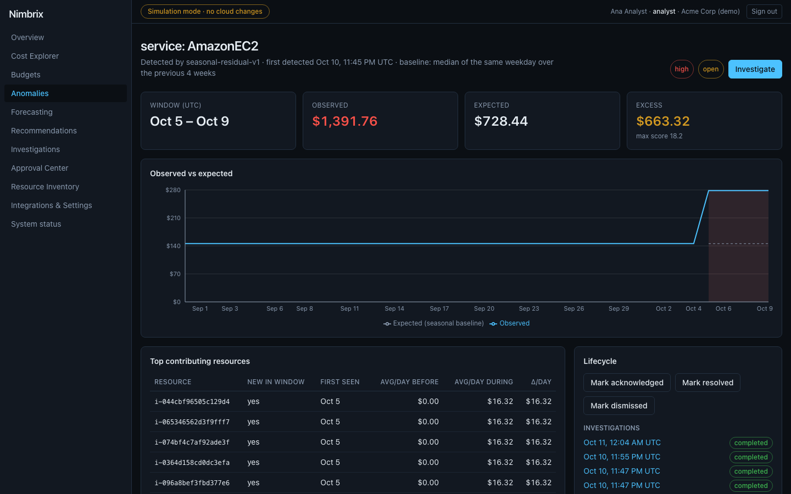
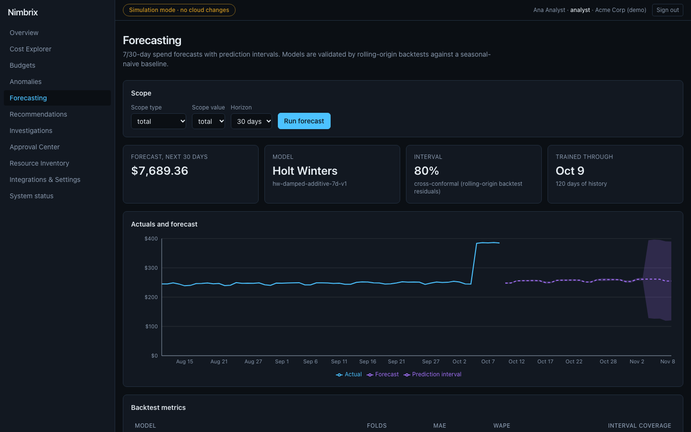
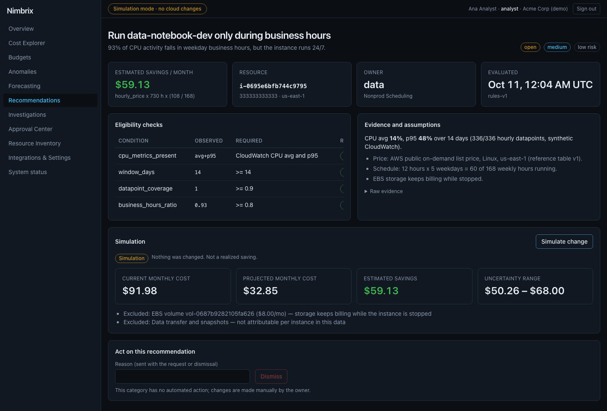
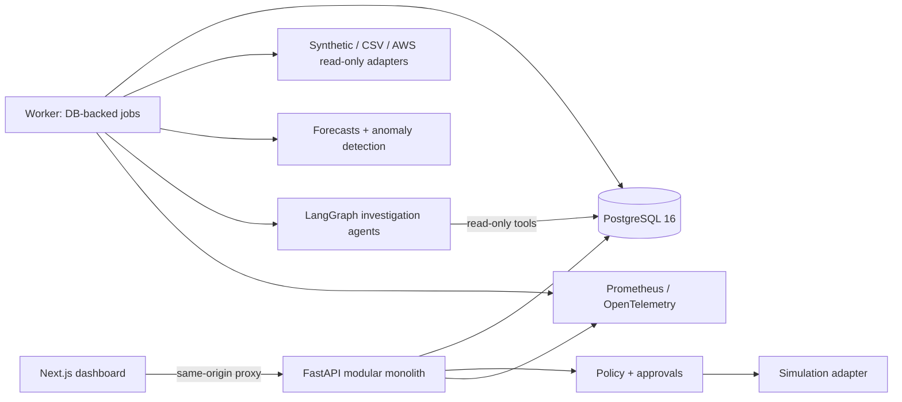

# Nimbrix

**Autonomous cloud cost intelligence and optimization — with a human in the loop.**

Nimbrix ingests cloud billing and inventory data, explains where money goes, detects cost
anomalies, forecasts spend, produces evidence-backed savings recommendations, simulates their
effect, and executes a deliberately tiny allowlist of actions **only after explicit human
approval** — in simulation mode, with a complete audit trail.

The whole platform runs locally with synthetic data: no cloud account, no credentials, and no
paid LLM key required.

## Demo

[](docs/media/nimbrix-demo.mp4)

▶ [Watch the full-resolution demo video (MP4, 71 s)](docs/media/nimbrix-demo.mp4)



## Highlights

- **Ingestion** — reproducible synthetic AWS-like dataset, validated CSV uploads with row-level
  errors, read-only AWS Cost Explorer / CUR (Athena) / EC2 + CloudWatch adapters (off by
  default), idempotent upserts that handle late-arriving corrections.
- **Deterministic analytics** — UTC-correct aggregations by account, service, region,
  environment, and team; allocated vs unallocated spend; month-to-date comparisons; budgets
  with forecast-based projections; exact `Decimal` money that never mixes currencies.
- **Recommendations** — five transparent rules (idle non-prod instances, rightsizing,
  unattached volumes, unused IPs, non-prod scheduling) with eligibility checks, evidence,
  assumptions, savings formulas, and explicit *insufficient evidence* when data is missing.
- **ML** — seasonal-naive baseline vs damped Holt-Winters with rolling-origin backtests and
  conformal intervals; an interpretable seasonal-residual anomaly detector measured on
  labeled data (precision 0.987 / recall 0.980 at default sensitivity).
- **Investigation agents** — a LangGraph state machine (triage → evidence → forecast →
  hypothesis → recommendations → policy review → report) with read-only, tenant-scoped tools,
  cited evidence, grounding validation against invented numbers, and a deterministic fallback.
  Optional Anthropic, OpenAI, or Ollama adapters.
- **Safe remediation** — action registry, 10-check policy engine, approval state machine with
  separation of duties, payload-hash binding, expiry, idempotent execution, revalidation right
  before execution, verification, and rollback plans.
- **Production-style foundations** — multi-tenant RBAC with five roles, CSRF protection,
  append-only audit log enforced by the database, rate limits, security headers, Prometheus
  metrics, OpenTelemetry tracing, Grafana dashboard, retention jobs, and a threat model.

| Investigation workspace | Approval center |
| --- | --- |
|  |  |
| **Cost explorer** | **Anomaly** |
|  |  |
| **Forecasting** | **Recommendation simulation** |
|  |  |

## Quickstart

Prerequisites: Docker with Compose v2. (For development and tests: Node.js 22+, [uv](https://docs.astral.sh/uv/).)

```bash
git clone <repository-url> nimbrix && cd nimbrix
cp .env.example .env            # local-only values; change the passwords if you like
make demo                       # build + start everything and seed demo data (opt-in)
scripts/wait-for-demo.sh        # waits until synthetic data is imported and analyzed
```

Open <http://127.0.0.1:3200> and sign in as `analyst@acme.demo` (password:
`NIMBRIX_DEMO_PASSWORD` from `.env`). Other demo users: `approver@`, `viewer@`, `auditor@`,
`admin@acme.demo`, and `admin@globex.demo` in a second tenant.

`make up` starts the same stack **without** seeding data. Optional observability:
`docker compose --profile observability up -d` → Prometheus `:9290`, Grafana `:3290`.

## The demo in one paragraph

A synthetic company's EC2 bill jumps when an 8-node batch fleet appears in a dev account.
Nimbrix flags the anomaly on day one, an investigation attributes 98% of the excess to the new
instances with cited evidence, the rule engine finds an idle dev build runner
(0.9% CPU, $280.32/month estimated), the simulation shows the cost delta and what it excludes,
an analyst requests a simulated stop, a different user approves the exact payload, the worker
re-validates and "stops" it in simulation, and every step lands in the audit trail.
Step-by-step script: [docs/demo.md](docs/demo.md).

## Architecture



| Topic | Document |
| --- | --- |
| Architecture, flows, trust boundaries | [docs/architecture.md](docs/architecture.md), [ADRs](docs/adr/README.md) |
| API reference (55 endpoints) | [docs/api.md](docs/api.md) |
| Database schema | [docs/database.md](docs/database.md) |
| Ingestion and AWS limitations | [docs/ingestion.md](docs/ingestion.md) |
| Analytics, budgets, rules, simulation | [docs/analytics.md](docs/analytics.md) |
| Forecasting and anomaly detection | [docs/ml.md](docs/ml.md) |
| Investigation agents | [docs/investigation-agents.md](docs/investigation-agents.md) |
| Approvals and remediation policy | [docs/remediation.md](docs/remediation.md) |
| Security, threat model, operations | [docs/security.md](docs/security.md), [docs/threat-model.md](docs/threat-model.md), [docs/operations.md](docs/operations.md) |
| AWS deployment (Terraform, validate-only) | [docs/deployment.md](docs/deployment.md) |
| Benchmarks | [docs/benchmarks.md](docs/benchmarks.md) |

## Tech stack

| Layer | Choice |
| --- | --- |
| Frontend | Next.js 16, React 19, TypeScript, Tailwind CSS 4, TanStack Query, Recharts, openapi-fetch |
| Backend | Python 3.12, FastAPI, Pydantic v2, SQLAlchemy 2, Alembic, psycopg 3 |
| Data / ML | PostgreSQL 16, pandas, NumPy, statsmodels |
| Agents | LangGraph; Anthropic SDK, OpenAI and Ollama HTTP adapters (all optional) |
| Cloud | boto3 (read-only), Terraform for AWS ECS Fargate + RDS + Secrets Manager |
| Ops | Docker Compose, GitHub Actions, Prometheus, Grafana, OpenTelemetry |
| Quality | pytest, Ruff, mypy (strict), Vitest, Testing Library, Playwright, ESLint, Prettier, gitleaks, pip-audit, actionlint |

## Tests and checks

```bash
make install              # uv sync + npm ci
make check                # lint, types, API unit + integration tests, web tests, build
make e2e                  # Playwright against the demo stack (make demo first)
```

| Suite | Count | Notes |
| --- | --- | --- |
| API unit + integration (real PostgreSQL 16) | 203 | tenancy, RBAC, CSRF, idempotency, ingestion, analytics precision, ML quality, agents, approvals, security |
| Web unit/component (Vitest) | 39 | API client, formatting, states, proxy |
| End-to-end (Playwright) | 12 | full demo path, policy denial, self-approval denial, viewer restrictions, backend failure |

CI runs all of the above plus migration up/down/drift checks, OpenAPI contract drift, Docker
builds, secret scanning, dependency audits, Terraform validation, and an observability smoke test.

## Measured performance

On an Apple M4 laptop (Docker Desktop, 10 CPUs): CSV ingestion ~2,900 rows/s, synthetic
ingestion ~3,300 rows/s, cost queries p95 53–110 ms on a 7.8k-row tenant and 83–200 ms on an
83k-row tenant at concurrency 10, and the full investigate → approve → execute → verify loop in
~2 s. Methodology and raw results: [docs/benchmarks.md](docs/benchmarks.md).

## Known limitations

- Demo authentication only; OIDC is designed but not implemented.
- No live cloud actions — by design. The single action is simulated.
- AWS adapters are tested against stubs; no real AWS account was used. CUR has no API entry point yet.
- LLM providers are tested against mocked responses; live provider calls are unverified.
- Prices come from a reference list-price table (no RI/Savings Plan/EDP discounts); CPU is the
  only utilization signal.
- Tenant isolation is application-enforced (no PostgreSQL row-level security); rate limits are
  per process.
- ML metrics are measured on synthetic data and will be lower on real billing data.

Full, phase-by-phase status: [docs/PROGRESS.md](docs/PROGRESS.md).

## Roadmap

OIDC sign-in · PostgreSQL row-level security · CUR connection settings in the UI · memory and
network utilization signals · a reviewed live `stop_nonprod_instance` action behind its own flag
and IAM role · materialized daily cost rollups for very large tenants.
