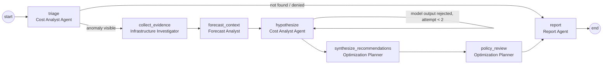

# Investigation Agents

Code: `apps/api/src/nimbrix_api/modules/agents/`. Design decision: [ADR-0004](adr/0004-model-provider.md).

## Graph

A LangGraph `StateGraph` with a typed state and explicit edges. Roles are fixed per node;
agents do not converse. The only loop is the bounded `hypothesize` retry (max 2 attempts).

## What each node does

| Node | Evidence / output |
| --- | --- |
| triage | Anomaly (`anomaly:<id>`), daily observed vs expected (`cost:<scope>:<date>`), 28-day pre-window baseline, earlier incidents |
| collect_evidence | Inventory for contributing resources (`resource:<id>`), pricing source |
| forecast_context | Latest forecast for the scope (`forecast:<id>`) |
| hypothesize | Deterministic attribution (`computed:attribution`), then the model's analysis (if configured) or the deterministic one |
| synthesize_recommendations | Existing rule-based recommendations for the resources/scope (`recommendation:<id>`) — never new savings figures |
| policy_review | Evaluates allowlisted actions against the policy engine, read-only; nothing is requested or executed |
| report | `InvestigationReport`: summary, root cause, hypotheses with citations, key figures, contributors, proposed actions, evidence index, limitations, rejected model output |

## Safety properties

- **Read-only tools.** Tools run in a PostgreSQL transaction started with
  `SET TRANSACTION READ ONLY`; a write raises (`test_agent_tools_cannot_write`). There is no
  write, approval, or cloud tool. Every query is filtered by the investigation's tenant;
  cross-tenant IDs raise `ToolAccessDeniedError` (`test_cross_tenant_and_rbac_are_enforced`).
- **Numbers come from code.** Dollar figures, percentages, and attribution are computed
  deterministically and stored as `computed:*` evidence. Models only contribute wording,
  citations, and confidence labels.
- **Grounding validation.** Model output is rejected if it cites an unknown evidence ID,
  mentions a resource ID, account, or dollar amount absent from evidence, claims `high`
  confidence with fewer than two citations, or offers no hypothesis without declaring
  `insufficient_evidence`. After two rejected attempts the deterministic analysis is used and
  the rejection reasons are kept in `model_output_rejected`.
- **Prompt injection.** Evidence is serialized as JSON inside `<evidence>` tags with secrets
  redacted; the system prompt declares it untrusted data. An injected answer (fake resource,
  invented $99,999) is rejected by grounding validation (`test_bad_model_output_falls_back_to_deterministic[injected]`).
- **Budgets.** `NIMBRIX_AGENT_MAX_STEPS` (12), `NIMBRIX_AGENT_TIMEOUT_SECONDS` (90),
  `NIMBRIX_AGENT_MAX_LLM_CALLS` (4), `NIMBRIX_LLM_TIMEOUT_SECONDS` (30),
  `NIMBRIX_LLM_MAX_OUTPUT_TOKENS` (1500). Exhausting a budget fails the investigation with the
  reason recorded. Cancellation (`POST /investigations/{id}/cancel`) is checked before every node.
- **Traceability.** Each investigation has a `trace_id`; each node writes an `agent_runs` row
  (role, mode, summary, evidence refs, tool calls, tokens, cost, latency, error). Reports are
  stored and exportable as Markdown (`GET /investigations/{id}/report.md`).

## Modes

| `NIMBRIX_LLM_PROVIDER` | Adapter | Notes |
| --- | --- | --- |
| `none` (default) | Deterministic investigator | Offline, reproducible; used by the demo and CI |
| `anthropic` | Official `anthropic` Python SDK, Messages API with `output_config.format` JSON schema | Requires `NIMBRIX_LLM_MODEL` and `NIMBRIX_LLM_API_KEY` |
| `openai` | HTTP `POST /v1/chat/completions` with a strict `json_schema` response format | Requires model and key; `NIMBRIX_LLM_BASE_URL` optional |
| `ollama` | HTTP `POST /api/chat` with `format` = JSON schema | Local; base URL defaults to `http://localhost:11434` |

The report and API show which mode produced each investigation (`mode`, `model`). Token usage
is recorded; cost is computed only if `NIMBRIX_LLM_INPUT_USD_PER_MILLION_TOKENS` and
`NIMBRIX_LLM_OUTPUT_USD_PER_MILLION_TOKENS` are set. No model name is assumed by default.

**Verification status:** adapters are tested against mocked HTTP responses and a fake SDK client
(structured output parsing, refusals, truncation, 429/5xx, network errors). **No live provider
call was made during development**, so live mode is unverified until an operator configures
credentials.
