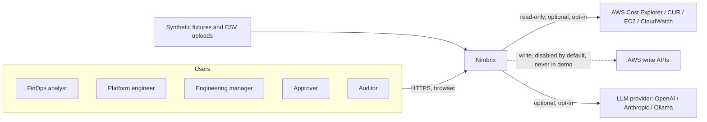
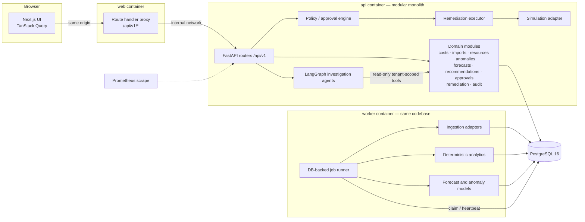
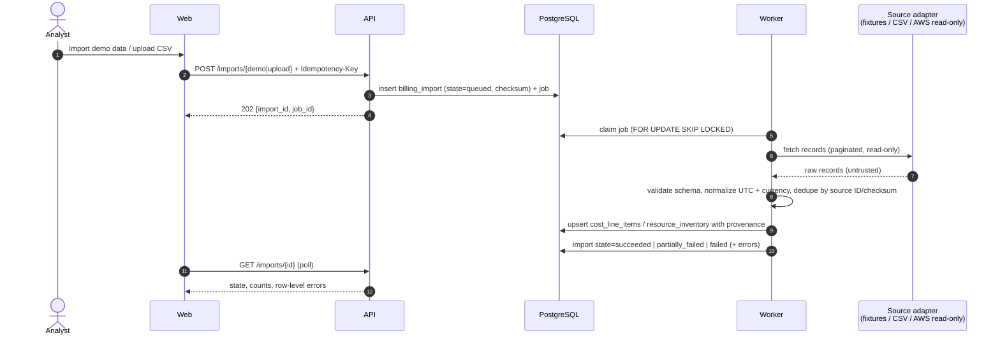
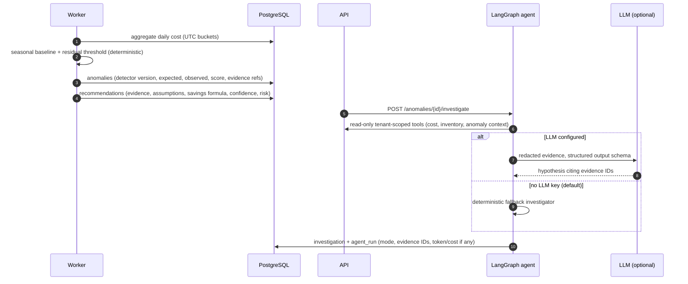
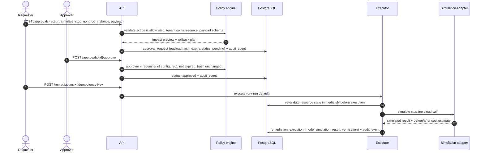
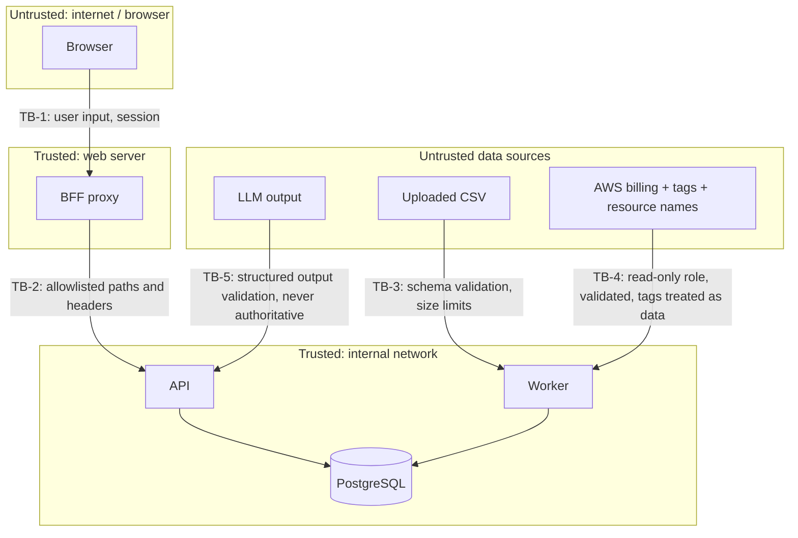
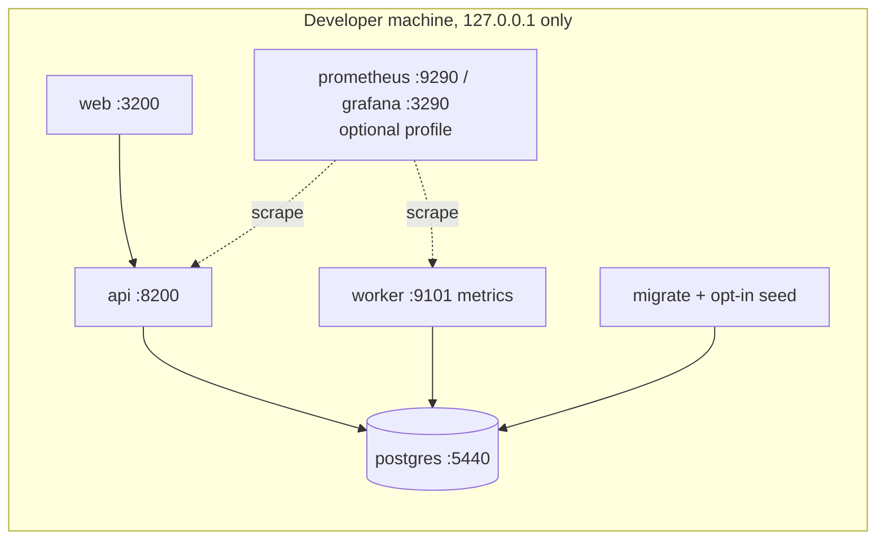

# Nimbrix Architecture

> Status: **implemented through Phase 9.** Everything described here exists and is tested,
> except items explicitly marked *not implemented* (OIDC, live cloud actions, CUR endpoint).
> The source of truth for decisions is [`docs/adr/`](adr/).

## 1. Purpose and scope

Nimbrix ingests cloud cost and resource data, explains where money goes, detects
anomalies and waste, forecasts spend, produces evidence-backed recommendations,
simulates savings, and executes a very small allowlist of safe actions **only after
explicit human approval**. The entire demo runs locally with synthetic data — no cloud
account, no paid model, no credentials.

Non-goals: real-time billing (cloud billing data is inherently delayed), autonomous
cloud writes, and LLM-computed dollar figures.

## 2. System context



Every external dependency is optional. The default configuration talks to nothing outside
the local Docker network.

## 3. Components



| Component | Responsibility | Code / docs |
| --- | --- | --- |
| Web (`apps/web`) | Next.js 16 dashboard (12 pages), typed API client, server-side proxy for `/api/v1/*` | `apps/web/src` |
| API (`apps/api`) | FastAPI modular monolith: auth, tenancy, ingestion requests, analytics, budgets, recommendations, ML results, investigations, approvals, audit | [api.md](api.md) |
| Worker | `nimbrix-worker`: claims DB-backed jobs (imports, analysis, forecasts, investigations, remediation), daily scheduling and retention | [ADR-0003](adr/0003-db-backed-jobs.md), [ingestion.md](ingestion.md) |
| PostgreSQL 16 | System of record: 24 tables, append-only audit trigger | [database.md](database.md) |
| Contracts (`packages/contracts`) | OpenAPI exported from code + generated TypeScript types | drift-checked in CI and tests |
| Analytics | Deterministic aggregations, budgets, `rules-v1`, simulation | [analytics.md](analytics.md) |
| ML | Seasonal-naive + Holt-Winters forecasts, `seasonal-residual-v1` anomalies | [ml.md](ml.md) |
| Agents | LangGraph investigation graph, read-only tools, provider adapters, deterministic fallback | [investigation-agents.md](investigation-agents.md) |
| Policy + executor | Action registry, approval state machine, simulation adapter | [remediation.md](remediation.md) |
| Observability | Prometheus metrics, OpenTelemetry traces, Grafana dashboard | [operations.md](operations.md#observability) |

### Request path

1. Browser requests `/status` from the web origin.
2. The status component polls `GET /api/v1/health/ready` on the **same origin**.
3. The Next.js route handler validates the path (rejects `.`/`..`, blocks
   `metrics`, `docs`, `openapi.json`), forwards only allowlisted headers, and calls
   `NIMBRIX_API_INTERNAL_URL` with a 10 s timeout.
4. The API assigns or propagates `X-Request-ID`, probes PostgreSQL (`SELECT 1`) and
   compares the Alembic revision with the packaged head, then returns 200 or 503.
5. Failures at any hop surface as the standard error envelope with the request ID.

## 4. Key flows

### 4.1 Ingestion



### 4.2 Analysis, anomaly, and investigation



Dollar amounts, forecasts, and risk scores are always computed deterministically. The
agent may only cite and explain them.

### 4.3 Remediation with approval



## 5. Trust boundaries



| Boundary | Threats | Controls |
| --- | --- | --- |
| TB-1 Browser → web | XSS, CSRF, session theft | ✅ No secrets or API URL in the bundle; ✅ same-origin proxy; ✅ HttpOnly SameSite cookies + session-bound CSRF token; ✅ CSP and framing protection |
| TB-2 Web → API | Path traversal, header smuggling, internal endpoint exposure | ✅ Segment validation, header allowlists both ways, `metrics`/`docs`/`openapi.json` blocked at the proxy, 10 s timeout |
| API → DB | SQL injection, cross-tenant reads | ✅ Parameterized queries, statement timeout; ✅ session-bound tenant filters on every query, cross-tenant IDs → 404 + audit |
| TB-3 CSV | Malicious/oversized files, formula injection | ✅ Body/upload size limits, strict per-row schema, values never evaluated, parsing in the worker |
| TB-4 AWS | Over-privileged credentials, tag-borne prompt injection | ✅ Assumed read-only role with external ID, no stored keys, AWS off by default, tags treated as data |
| TB-5 LLM | Prompt injection, hallucinated resources or dollars | ✅ Structured outputs citing evidence IDs, grounding validation, deterministic numbers, read-only tools in READ ONLY transactions |
| Logs/telemetry | Secret or billing data leakage | ✅ JSON logs with URL-credential and key=value redaction; ✅ config errors never echo values; ✅ readiness never returns raw DB errors |

## 6. Data freshness (batch, not real time)

Nimbrix is a **batch analytics** system. It never presents data as real-time.

| Source | Typical freshness | How Nimbrix treats it |
| --- | --- | --- |
| Synthetic fixtures | Instant, deterministic | Labeled `demo` everywhere |
| CSV upload | As of the file's contents | Stored with import timestamp + checksum |
| AWS Cost Explorer | Updated several times per day; recent days are estimates and can change | Re-ingest a trailing window; `estimated` provenance flag; "as of" dates |
| AWS CUR (S3/Athena) | Delivered up to several times daily; finalized after month close | Adapter implemented; no API entry point yet |
| CloudWatch metrics | Minutes; aggregated over a utilization window | Window, statistic, and datapoint coverage stored as evidence |

Late-arriving records are handled by idempotent upserts keyed on source identifiers, so
re-imports correct prior values instead of duplicating them.

## 7. Simulated versus live behavior

| Capability | Simulated (default, only mode in demo) | Live (opt-in, later phases) |
| --- | --- | --- |
| Billing data | Synthetic fixtures, CSV | AWS Cost Explorer / CUR via read-only role |
| Investigations | Deterministic fallback investigator | Configured LLM provider, still read-only |
| Remediation | `simulate_stop_nonprod_instance` via simulation adapter | **Not implemented.** Requires a separate feature flag, narrow IAM role, resource allowlist, and approval ([ADR-0005](adr/0005-safety-policy.md)) |

Enforcement: `NIMBRIX_LIVE_ACTIONS_ENABLED=true` is **rejected at startup**,
the readiness payload reports `remediation_mode: "simulation_only"`, and the UI header
shows "Simulation mode · no cloud connections" on every page.

## 8. Deployment topology (local)



`docker compose up --build --wait` starts PostgreSQL → runs `alembic upgrade head` in a
one-shot `migrate` container (which seeds demo data only when `NIMBRIX_DEMO_SEED=true`) →
starts the API and worker → starts the web app. Containers run as non-root users with health
checks. AWS deployment (ECS Fargate, RDS, Secrets Manager) is described in
[deployment.md](deployment.md); its Terraform is validated but never applied by this project.

## 9. Repository layout

```text
apps/api/                 FastAPI app + worker, Alembic migrations (packaged), tests/{unit,integration}
apps/web/                 Next.js app, Vitest component/unit tests
packages/contracts/       openapi.json + generated TypeScript types (drift-checked)
infrastructure/docker/    api.Dockerfile, web.Dockerfile
infrastructure/observability/  Prometheus config, Grafana provisioning + dashboard
infrastructure/terraform/aws/  ECS Fargate + RDS + Secrets Manager (validate-only)
data/fixtures/            CSV test fixtures (synthetic)
scripts/                  demo wait, reference-doc generator, benchmarks
tests/e2e/                Playwright tests against the running stack
tests/performance/        load test for cost queries
docs/                     architecture, ADRs, API, schema, security, threat model, ops, ML, demo, results
```

Deviations from the proposed layout, with reasons:

- **`workers/`** is not a separate top-level package: the worker is a second entrypoint
  of the API package so it shares domain models, repositories, and tenant guards
  ([ADR-0003](adr/0003-db-backed-jobs.md)).
- **API integration tests** live in `apps/api/tests/integration` (not root
  `tests/integration`) so they run inside the API's locked Python environment.
  Cross-service E2E tests live in root `tests/e2e`.

## 10. Engineering conventions

See [AGENTS.md](../AGENTS.md) for the full list. Highlights: UTC everywhere; `Decimal`
for money with an explicit ISO currency code; UUID primary keys; explicit constraint
naming; every mutation endpoint takes an `Idempotency-Key`; stable error envelope;
module routers declare the full `/api/v1` prefix (metrics label by route template).
