# Database Schema

Generated from the SQLAlchemy models (`scripts/generate_reference_docs.py`); migrations in
`apps/api/src/nimbrix_api/migrations/versions/` are the source of truth for DDL and are
checked for drift with `alembic check` in CI.

Conventions: UUID primary keys (`gen_random_uuid()`), `timestamptz` UTC timestamps,
`NUMERIC(18,6)` money with an ISO currency column, `tenant_id` on every tenant-owned table,
CHECK constraints for status vocabularies, and an append-only trigger on `audit_events`.

```mermaid
erDiagram
  users ||--o{ anomalies : "status_changed_by"
  tenants ||--o{ anomalies : "tenant_id"
  users ||--o{ audit_events : "actor_id"
  tenants ||--o{ audit_events : "tenant_id"
  tenants ||--o{ budgets : "tenant_id"
  users ||--o{ cloud_connections : "created_by"
  tenants ||--o{ cloud_connections : "tenant_id"
  tenants ||--o{ forecasts : "tenant_id"
  tenants ||--o{ idempotency_keys : "tenant_id"
  users ||--o{ idempotency_keys : "user_id"
  users ||--o{ jobs : "created_by"
  tenants ||--o{ jobs : "tenant_id"
  roles ||--o{ memberships : "role_id"
  tenants ||--o{ memberships : "tenant_id"
  users ||--o{ memberships : "user_id"
  tenants ||--o{ recommendations : "tenant_id"
  users ||--o{ sessions : "user_id"
  tenants ||--o{ sessions : "tenant_id"
  users ||--o{ approval_requests : "decided_by"
  recommendations ||--o{ approval_requests : "recommendation_id"
  users ||--o{ approval_requests : "requested_by"
  tenants ||--o{ approval_requests : "tenant_id"
  tenants ||--o{ billing_imports : "tenant_id"
  users ||--o{ billing_imports : "requested_by"
  cloud_connections ||--o{ billing_imports : "connection_id"
  budgets ||--o{ budget_alerts : "budget_id"
  tenants ||--o{ budget_alerts : "tenant_id"
  tenants ||--o{ investigations : "tenant_id"
  anomalies ||--o{ investigations : "anomaly_id"
  users ||--o{ investigations : "requested_by"
  tenants ||--o{ agent_runs : "tenant_id"
  investigations ||--o{ agent_runs : "investigation_id"
  tenants ||--o{ cost_line_items : "tenant_id"
  billing_imports ||--o{ cost_line_items : "import_id"
  tenants ||--o{ import_files : "tenant_id"
  billing_imports ||--o{ import_files : "import_id"
  users ||--o{ remediation_executions : "executed_by"
  tenants ||--o{ remediation_executions : "tenant_id"
  approval_requests ||--o{ remediation_executions : "approval_request_id"
  tenants ||--o{ resource_inventory : "tenant_id"
  billing_imports ||--o{ resource_inventory : "import_id"
  tenants ||--o{ simulated_resource_states : "tenant_id"
  remediation_executions ||--o{ simulated_resource_states : "execution_id"
```

## `roles`

| Column | Type | Null | Notes |
| --- | --- | --- | --- |
| `name` | VARCHAR(32) | no |  |
| `description` | VARCHAR(500) | no |  |
| `permissions` | ARRAY | no |  |
| `id` | CHAR(32) | no | PK |
| `updated_at` | DATETIME | no |  |
| `created_at` | DATETIME | no |  |

Unique: (name)

Checks: `name IN ('viewer', 'analyst', 'approver', 'auditor', 'admin')`

## `tenants`

| Column | Type | Null | Notes |
| --- | --- | --- | --- |
| `slug` | VARCHAR(63) | no |  |
| `name` | VARCHAR(200) | no |  |
| `id` | CHAR(32) | no | PK |
| `updated_at` | DATETIME | no |  |
| `created_at` | DATETIME | no |  |

Unique: (slug)

Checks: `slug ~ '^[a-z0-9][a-z0-9-]{1,62}$'`

## `users`

| Column | Type | Null | Notes |
| --- | --- | --- | --- |
| `email` | VARCHAR(320) | no |  |
| `display_name` | VARCHAR(200) | no |  |
| `password_hash` | VARCHAR(255) | yes |  |
| `is_active` | BOOLEAN | no |  |
| `id` | CHAR(32) | no | PK |
| `updated_at` | DATETIME | no |  |
| `created_at` | DATETIME | no |  |

Unique: (email)

Checks: `email = lower(email)`

## `anomalies`

| Column | Type | Null | Notes |
| --- | --- | --- | --- |
| `dedupe_key` | VARCHAR(512) | no |  |
| `detector_version` | VARCHAR(64) | no |  |
| `scope_type` | VARCHAR(32) | no |  |
| `scope_value` | VARCHAR(512) | no |  |
| `window_start` | DATE | no |  |
| `window_end` | DATE | no |  |
| `expected` | NUMERIC(18, 6) | no |  |
| `observed` | NUMERIC(18, 6) | no |  |
| `currency` | VARCHAR(3) | no |  |
| `score` | DOUBLE | no |  |
| `severity` | VARCHAR(16) | no |  |
| `status` | VARCHAR(16) | no |  |
| `evidence` | JSONB | no |  |
| `first_detected_at` | DATETIME | no |  |
| `last_detected_at` | DATETIME | no |  |
| `status_changed_by` | CHAR(32) | yes | FK → `users.id` |
| `id` | CHAR(32) | no | PK |
| `tenant_id` | CHAR(32) | no | FK → `tenants.id` |
| `updated_at` | DATETIME | no |  |
| `created_at` | DATETIME | no |  |

Unique: (tenant_id, dedupe_key)

Checks: `severity IN ('low', 'medium', 'high')`; `status IN ('open', 'acknowledged', 'resolved', 'dismissed')`

## `audit_events`

| Column | Type | Null | Notes |
| --- | --- | --- | --- |
| `tenant_id` | CHAR(32) | yes | FK → `tenants.id` |
| `occurred_at` | DATETIME | no |  |
| `actor_type` | VARCHAR(16) | no |  |
| `actor_id` | CHAR(32) | yes | FK → `users.id` |
| `actor_label` | VARCHAR(320) | yes |  |
| `event_type` | VARCHAR(64) | no |  |
| `target_type` | VARCHAR(64) | yes |  |
| `target_id` | VARCHAR(512) | yes |  |
| `outcome` | VARCHAR(16) | no |  |
| `request_id` | VARCHAR(64) | yes |  |
| `payload` | JSONB | no |  |
| `id` | CHAR(32) | no | PK |

Checks: `actor_type IN ('user', 'system', 'agent', 'anonymous')`

## `budgets`

| Column | Type | Null | Notes |
| --- | --- | --- | --- |
| `name` | VARCHAR(200) | no |  |
| `scope_type` | VARCHAR(32) | no |  |
| `scope_value` | VARCHAR(256) | yes |  |
| `period` | VARCHAR(16) | no |  |
| `amount` | NUMERIC(18, 6) | no |  |
| `currency` | VARCHAR(3) | no |  |
| `alert_thresholds` | JSONB | no |  |
| `owner` | VARCHAR(128) | yes |  |
| `id` | CHAR(32) | no | PK |
| `tenant_id` | CHAR(32) | no | FK → `tenants.id` |
| `updated_at` | DATETIME | no |  |
| `created_at` | DATETIME | no |  |

Unique: (tenant_id, name)

Checks: `period IN ('monthly')`; `amount > 0`; `scope_type IN ('total', 'account', 'service', 'team', 'environment')`

## `cloud_connections`

| Column | Type | Null | Notes |
| --- | --- | --- | --- |
| `provider` | VARCHAR(16) | no |  |
| `name` | VARCHAR(200) | no |  |
| `account_id` | VARCHAR(32) | no |  |
| `role_arn` | VARCHAR(2048) | yes |  |
| `external_id` | VARCHAR(1224) | yes |  |
| `regions` | JSONB | no |  |
| `access_mode` | VARCHAR(16) | no |  |
| `status` | VARCHAR(16) | no |  |
| `last_validated_at` | DATETIME | yes |  |
| `last_error` | VARCHAR(1000) | yes |  |
| `settings` | JSONB | no |  |
| `created_by` | CHAR(32) | yes | FK → `users.id` |
| `id` | CHAR(32) | no | PK |
| `tenant_id` | CHAR(32) | no | FK → `tenants.id` |
| `updated_at` | DATETIME | no |  |
| `created_at` | DATETIME | no |  |

Unique: (tenant_id, provider, account_id)

Checks: `status IN ('pending', 'validated', 'failed', 'disabled')`; `access_mode IN ('read_only')`; `provider IN ('aws')`

## `forecasts`

| Column | Type | Null | Notes |
| --- | --- | --- | --- |
| `scope_type` | VARCHAR(32) | no |  |
| `scope_value` | VARCHAR(512) | no |  |
| `model_name` | VARCHAR(64) | no |  |
| `model_version` | VARCHAR(64) | no |  |
| `feature_version` | VARCHAR(64) | no |  |
| `horizon_days` | INTEGER | no |  |
| `interval_level` | DOUBLE | no |  |
| `training_start` | DATE | yes |  |
| `training_end` | DATE | yes |  |
| `currency` | VARCHAR(3) | no |  |
| `status` | VARCHAR(32) | no |  |
| `points` | JSONB | no |  |
| `metrics` | JSONB | no |  |
| `message` | VARCHAR(1000) | yes |  |
| `id` | CHAR(32) | no | PK |
| `tenant_id` | CHAR(32) | no | FK → `tenants.id` |
| `updated_at` | DATETIME | no |  |
| `created_at` | DATETIME | no |  |

Checks: `status IN ('succeeded', 'insufficient_data', 'failed')`

## `idempotency_keys`

| Column | Type | Null | Notes |
| --- | --- | --- | --- |
| `user_id` | CHAR(32) | no | FK → `users.id` |
| `key` | VARCHAR(128) | no |  |
| `method` | VARCHAR(8) | no |  |
| `path` | VARCHAR(512) | no |  |
| `request_hash` | VARCHAR(64) | no |  |
| `status_code` | INTEGER | yes |  |
| `response_body` | JSONB | yes |  |
| `expires_at` | DATETIME | no |  |
| `id` | CHAR(32) | no | PK |
| `tenant_id` | CHAR(32) | no | FK → `tenants.id` |
| `updated_at` | DATETIME | no |  |
| `created_at` | DATETIME | no |  |

Unique: (tenant_id, user_id, key)

## `jobs`

| Column | Type | Null | Notes |
| --- | --- | --- | --- |
| `kind` | VARCHAR(64) | no |  |
| `payload` | JSONB | no |  |
| `state` | VARCHAR(16) | no |  |
| `attempts` | INTEGER | no |  |
| `max_attempts` | INTEGER | no |  |
| `run_after` | DATETIME | no |  |
| `locked_by` | VARCHAR(128) | yes |  |
| `locked_until` | DATETIME | yes |  |
| `dedupe_key` | VARCHAR(256) | yes |  |
| `result` | JSONB | yes |  |
| `error` | VARCHAR(2000) | yes |  |
| `created_by` | CHAR(32) | yes | FK → `users.id` |
| `started_at` | DATETIME | yes |  |
| `finished_at` | DATETIME | yes |  |
| `id` | CHAR(32) | no | PK |
| `tenant_id` | CHAR(32) | no | FK → `tenants.id` |
| `updated_at` | DATETIME | no |  |
| `created_at` | DATETIME | no |  |

Checks: `state IN ('queued', 'running', 'succeeded', 'failed', 'cancelled')`

## `memberships`

| Column | Type | Null | Notes |
| --- | --- | --- | --- |
| `tenant_id` | CHAR(32) | no | FK → `tenants.id` |
| `user_id` | CHAR(32) | no | FK → `users.id` |
| `role_id` | CHAR(32) | no | FK → `roles.id` |
| `id` | CHAR(32) | no | PK |
| `updated_at` | DATETIME | no |  |
| `created_at` | DATETIME | no |  |

Unique: (tenant_id, user_id)

## `recommendations`

| Column | Type | Null | Notes |
| --- | --- | --- | --- |
| `dedupe_key` | VARCHAR(512) | no |  |
| `category` | VARCHAR(64) | no |  |
| `rule_version` | VARCHAR(64) | no |  |
| `title` | VARCHAR(300) | no |  |
| `summary` | VARCHAR(2000) | no |  |
| `resource_id` | VARCHAR(512) | yes |  |
| `account_id` | VARCHAR(32) | yes |  |
| `region` | VARCHAR(32) | yes |  |
| `affected_resources` | JSONB | no |  |
| `evidence` | JSONB | no |  |
| `eligibility` | JSONB | no |  |
| `assumptions` | JSONB | no |  |
| `savings_formula` | VARCHAR(1000) | yes |  |
| `estimated_monthly_savings` | NUMERIC(18, 6) | yes |  |
| `currency` | VARCHAR(3) | no |  |
| `confidence` | VARCHAR(32) | no |  |
| `risk` | VARCHAR(16) | no |  |
| `owner` | VARCHAR(128) | yes |  |
| `status` | VARCHAR(32) | no |  |
| `utilization_window` | JSONB | yes |  |
| `last_simulation` | JSONB | yes |  |
| `proposed_action` | VARCHAR(64) | yes |  |
| `last_evaluated_at` | DATETIME | no |  |
| `id` | CHAR(32) | no | PK |
| `tenant_id` | CHAR(32) | no | FK → `tenants.id` |
| `updated_at` | DATETIME | no |  |
| `created_at` | DATETIME | no |  |

Unique: (tenant_id, dedupe_key)

Checks: `status IN ('open', 'insufficient_evidence', 'dismissed', 'approval_requested', 'actioned', 'superseded')`; `confidence IN ('low', 'medium', 'high', 'insufficient_evidence')`; `risk IN ('low', 'medium', 'high')`

## `sessions`

| Column | Type | Null | Notes |
| --- | --- | --- | --- |
| `token_hash` | VARCHAR(64) | no |  |
| `csrf_token_hash` | VARCHAR(64) | no |  |
| `user_id` | CHAR(32) | no | FK → `users.id` |
| `tenant_id` | CHAR(32) | no | FK → `tenants.id` |
| `expires_at` | DATETIME | no |  |
| `revoked_at` | DATETIME | yes |  |
| `last_seen_at` | DATETIME | yes |  |
| `user_agent` | VARCHAR(256) | yes |  |
| `id` | CHAR(32) | no | PK |
| `updated_at` | DATETIME | no |  |
| `created_at` | DATETIME | no |  |

Unique: (token_hash)

## `approval_requests`

| Column | Type | Null | Notes |
| --- | --- | --- | --- |
| `action_type` | VARCHAR(64) | no |  |
| `payload` | JSONB | no |  |
| `payload_hash` | VARCHAR(64) | no |  |
| `target_resource_id` | VARCHAR(512) | no |  |
| `recommendation_id` | CHAR(32) | yes | FK → `recommendations.id` |
| `requested_by` | CHAR(32) | no | FK → `users.id` |
| `decided_by` | CHAR(32) | yes | FK → `users.id` |
| `decision_reason` | VARCHAR(2000) | yes |  |
| `status` | VARCHAR(16) | no |  |
| `policy_result` | JSONB | no |  |
| `impact_preview` | JSONB | no |  |
| `rollback_plan` | JSONB | no |  |
| `expires_at` | DATETIME | no |  |
| `decided_at` | DATETIME | yes |  |
| `idempotency_key` | VARCHAR(128) | no |  |
| `id` | CHAR(32) | no | PK |
| `tenant_id` | CHAR(32) | no | FK → `tenants.id` |
| `updated_at` | DATETIME | no |  |
| `created_at` | DATETIME | no |  |

Unique: (tenant_id, idempotency_key)

Checks: `status IN ('pending', 'approved', 'rejected', 'expired', 'cancelled', 'executed')`

## `billing_imports`

| Column | Type | Null | Notes |
| --- | --- | --- | --- |
| `source` | VARCHAR(32) | no |  |
| `state` | VARCHAR(32) | no |  |
| `checksum` | VARCHAR(64) | yes |  |
| `period_start` | DATE | yes |  |
| `period_end` | DATE | yes |  |
| `filename` | VARCHAR(255) | yes |  |
| `rows_received` | INTEGER | no |  |
| `rows_inserted` | INTEGER | no |  |
| `rows_updated` | INTEGER | no |  |
| `rows_unchanged` | INTEGER | no |  |
| `rows_rejected` | INTEGER | no |  |
| `resources_upserted` | INTEGER | no |  |
| `errors` | JSONB | no |  |
| `details` | JSONB | no |  |
| `duplicate_of` | CHAR(32) | yes | FK → `billing_imports.id` |
| `connection_id` | CHAR(32) | yes | FK → `cloud_connections.id` |
| `requested_by` | CHAR(32) | yes | FK → `users.id` |
| `started_at` | DATETIME | yes |  |
| `finished_at` | DATETIME | yes |  |
| `id` | CHAR(32) | no | PK |
| `tenant_id` | CHAR(32) | no | FK → `tenants.id` |
| `updated_at` | DATETIME | no |  |
| `created_at` | DATETIME | no |  |

Checks: `source IN ('demo', 'csv', 'aws_cost_explorer', 'aws_cur')`; `state IN ('queued', 'running', 'succeeded', 'partially_failed', 'failed', 'duplicate')`

## `budget_alerts`

| Column | Type | Null | Notes |
| --- | --- | --- | --- |
| `budget_id` | CHAR(32) | no | FK → `budgets.id` |
| `period_start` | DATE | no |  |
| `threshold` | NUMERIC(18, 6) | no |  |
| `kind` | VARCHAR(16) | no |  |
| `utilization` | NUMERIC(18, 6) | no |  |
| `amount` | NUMERIC(18, 6) | no |  |
| `currency` | VARCHAR(3) | no |  |
| `status` | VARCHAR(16) | no |  |
| `details` | JSONB | no |  |
| `id` | CHAR(32) | no | PK |
| `tenant_id` | CHAR(32) | no | FK → `tenants.id` |
| `updated_at` | DATETIME | no |  |
| `created_at` | DATETIME | no |  |

Unique: (budget_id, period_start, threshold, kind)

Checks: `kind IN ('actual', 'forecast')`; `status IN ('open', 'acknowledged', 'resolved')`

## `investigations`

| Column | Type | Null | Notes |
| --- | --- | --- | --- |
| `anomaly_id` | CHAR(32) | yes | FK → `anomalies.id` |
| `state` | VARCHAR(16) | no |  |
| `mode` | VARCHAR(32) | no |  |
| `model` | VARCHAR(128) | yes |  |
| `trace_id` | VARCHAR(64) | no |  |
| `question` | VARCHAR(2000) | yes |  |
| `report` | JSONB | yes |  |
| `evidence` | JSONB | no |  |
| `budget` | JSONB | no |  |
| `usage` | JSONB | no |  |
| `error` | VARCHAR(2000) | yes |  |
| `cancel_requested` | BOOLEAN | no |  |
| `requested_by` | CHAR(32) | yes | FK → `users.id` |
| `started_at` | DATETIME | yes |  |
| `finished_at` | DATETIME | yes |  |
| `id` | CHAR(32) | no | PK |
| `tenant_id` | CHAR(32) | no | FK → `tenants.id` |
| `updated_at` | DATETIME | no |  |
| `created_at` | DATETIME | no |  |

Checks: `state IN ('queued', 'running', 'completed', 'failed', 'cancelled')`

## `agent_runs`

| Column | Type | Null | Notes |
| --- | --- | --- | --- |
| `investigation_id` | CHAR(32) | no | FK → `investigations.id` |
| `step_index` | INTEGER | no |  |
| `node` | VARCHAR(64) | no |  |
| `agent_role` | VARCHAR(64) | no |  |
| `status` | VARCHAR(16) | no |  |
| `mode` | VARCHAR(32) | no |  |
| `summary` | VARCHAR(2000) | no |  |
| `output` | JSONB | no |  |
| `evidence_refs` | JSONB | no |  |
| `tool_calls` | JSONB | no |  |
| `tokens_in` | INTEGER | yes |  |
| `tokens_out` | INTEGER | yes |  |
| `cost_usd` | NUMERIC(18, 6) | yes |  |
| `latency_ms` | DOUBLE | no |  |
| `error` | VARCHAR(2000) | yes |  |
| `id` | CHAR(32) | no | PK |
| `tenant_id` | CHAR(32) | no | FK → `tenants.id` |
| `created_at` | DATETIME | no |  |

Unique: (investigation_id, step_index)

## `cost_line_items`

| Column | Type | Null | Notes |
| --- | --- | --- | --- |
| `provider` | VARCHAR(16) | no |  |
| `source_record_id` | VARCHAR(256) | no |  |
| `import_id` | CHAR(32) | no | FK → `billing_imports.id` |
| `account_id` | VARCHAR(32) | no |  |
| `service` | VARCHAR(128) | no |  |
| `region` | VARCHAR(32) | yes |  |
| `resource_id` | VARCHAR(512) | yes |  |
| `usage_type` | VARCHAR(256) | yes |  |
| `usage_start` | DATETIME | no |  |
| `usage_end` | DATETIME | no |  |
| `usage_date` | DATE | no |  |
| `amount` | NUMERIC(18, 6) | no |  |
| `currency` | VARCHAR(3) | no |  |
| `usage_quantity` | NUMERIC(24, 8) | yes |  |
| `usage_unit` | VARCHAR(64) | yes |  |
| `tags` | JSONB | no |  |
| `environment` | VARCHAR(64) | yes |  |
| `team` | VARCHAR(128) | yes |  |
| `provenance` | JSONB | no |  |
| `id` | CHAR(32) | no | PK |
| `tenant_id` | CHAR(32) | no | FK → `tenants.id` |
| `updated_at` | DATETIME | no |  |
| `created_at` | DATETIME | no |  |

Unique: (tenant_id, provider, source_record_id)

Checks: `currency ~ '^[A-Z]{3}$'`; `usage_end >= usage_start`

## `import_files`

| Column | Type | Null | Notes |
| --- | --- | --- | --- |
| `import_id` | CHAR(32) | no | FK → `billing_imports.id` |
| `filename` | VARCHAR(255) | no |  |
| `content_type` | VARCHAR(128) | yes |  |
| `size_bytes` | INTEGER | no |  |
| `sha256` | VARCHAR(64) | no |  |
| `content` | BLOB | no |  |
| `id` | CHAR(32) | no | PK |
| `tenant_id` | CHAR(32) | no | FK → `tenants.id` |
| `updated_at` | DATETIME | no |  |
| `created_at` | DATETIME | no |  |

Unique: (import_id)

## `remediation_executions`

| Column | Type | Null | Notes |
| --- | --- | --- | --- |
| `approval_request_id` | CHAR(32) | no | FK → `approval_requests.id` |
| `idempotency_key` | VARCHAR(128) | no |  |
| `action_type` | VARCHAR(64) | no |  |
| `mode` | VARCHAR(16) | no |  |
| `dry_run` | BOOLEAN | no |  |
| `state` | VARCHAR(16) | no |  |
| `attempts` | INTEGER | no |  |
| `result` | JSONB | no |  |
| `verification` | JSONB | no |  |
| `rollback_plan` | JSONB | no |  |
| `error` | VARCHAR(2000) | yes |  |
| `executed_by` | CHAR(32) | no | FK → `users.id` |
| `started_at` | DATETIME | yes |  |
| `finished_at` | DATETIME | yes |  |
| `id` | CHAR(32) | no | PK |
| `tenant_id` | CHAR(32) | no | FK → `tenants.id` |
| `updated_at` | DATETIME | no |  |
| `created_at` | DATETIME | no |  |

Unique: (tenant_id, idempotency_key); (approval_request_id)

Checks: `mode IN ('simulation', 'live')`; `state IN ('pending', 'running', 'succeeded', 'failed')`

## `resource_inventory`

| Column | Type | Null | Notes |
| --- | --- | --- | --- |
| `provider` | VARCHAR(16) | no |  |
| `account_id` | VARCHAR(32) | no |  |
| `region` | VARCHAR(32) | no |  |
| `resource_id` | VARCHAR(512) | no |  |
| `resource_type` | VARCHAR(64) | no |  |
| `name` | VARCHAR(256) | yes |  |
| `state` | VARCHAR(32) | no |  |
| `tags` | JSONB | no |  |
| `environment` | VARCHAR(64) | yes |  |
| `team` | VARCHAR(128) | yes |  |
| `attributes` | JSONB | no |  |
| `hourly_cost` | NUMERIC(18, 6) | yes |  |
| `monthly_cost` | NUMERIC(18, 6) | yes |  |
| `currency` | VARCHAR(3) | no |  |
| `utilization` | JSONB | yes |  |
| `observed_at` | DATETIME | no |  |
| `source` | VARCHAR(32) | no |  |
| `import_id` | CHAR(32) | yes | FK → `billing_imports.id` |
| `id` | CHAR(32) | no | PK |
| `tenant_id` | CHAR(32) | no | FK → `tenants.id` |
| `updated_at` | DATETIME | no |  |
| `created_at` | DATETIME | no |  |

Unique: (tenant_id, provider, resource_id)

## `simulated_resource_states`

| Column | Type | Null | Notes |
| --- | --- | --- | --- |
| `resource_id` | VARCHAR(512) | no |  |
| `simulated_state` | VARCHAR(32) | no |  |
| `execution_id` | CHAR(32) | no | FK → `remediation_executions.id` |
| `id` | CHAR(32) | no | PK |
| `tenant_id` | CHAR(32) | no | FK → `tenants.id` |
| `updated_at` | DATETIME | no |  |
| `created_at` | DATETIME | no |  |

Unique: (tenant_id, resource_id)

