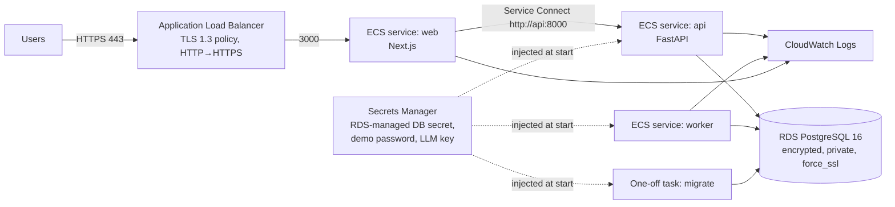

# Deploying to AWS (ECS Fargate + RDS + Secrets Manager)

> **Nothing in this repository provisions infrastructure automatically.** The Terraform in
> `infrastructure/terraform/aws` is validated in CI (`fmt`, `validate`) but has never been
> planned or applied against an AWS account by this project. Review every plan by hand, and
> apply only with explicit approval. It creates billable resources (ALB, RDS, Fargate tasks,
> NAT/VPC endpoints you provide).

## Topology



Security groups allow only ALB→web, web→api, api/worker→RDS, and outbound HTTPS. Tasks run
in private subnets without public IPs. The DB password exists only in the RDS-managed secret;
ECS injects `NIMBRIX_DB_USER`/`NIMBRIX_DB_PASSWORD` and the API composes its database URL.

## Procedure

1. **Prerequisites:** a VPC with public and private subnets in two AZs, NAT or VPC endpoints
   (ECR API/DKR, S3, Logs, Secrets Manager), an ACM certificate, an S3 backend for state.
2. **Images:** build both images and push them with an immutable tag:
   ```bash
   docker build -f infrastructure/docker/api.Dockerfile -t <ecr>/nimbrix-api:<sha> .
   docker build -f infrastructure/docker/web.Dockerfile -t <ecr>/nimbrix-web:<sha> .
   ```
3. **Plan:** `cd infrastructure/terraform/aws && terraform init && terraform plan -out plan.tfplan`
   with a `terraform.tfvars` based on `terraform.tfvars.example`. Read the whole plan.
4. **Apply (only with approval):** `terraform apply plan.tfplan`.
5. **Secrets:** `aws secretsmanager put-secret-value --secret-id nimbrix/demo-password --secret-string …`
   (only for private demos; see below). Leave `nimbrix/llm-api-key` empty unless an LLM is configured.
6. **Migrate:** run the migrate task once per release before updating services:
   ```bash
   aws ecs run-task --cluster nimbrix --launch-type FARGATE \
     --task-definition $(terraform output -raw migrate_task_definition) \
     --network-configuration 'awsvpcConfiguration={subnets=[<private>],securityGroups=[<worker-sg>]}'
   ```
7. **Deploy:** update `image_tag`, plan, apply. Services use circuit breakers with rollback.
8. **Verify:** `https://<alb>/status` shows Ready; `/api/v1/health/ready` is reachable only through the web tier.

## Identity caveat

The API refuses to start in `production` with demo password auth unless
`allow_demo_auth_in_production = true` is set explicitly. OIDC is designed
([ADR-0007](adr/0007-authentication-and-tenancy.md)) but not implemented, so a production-grade
deployment needs that work first. A private portfolio demo can opt in, restricted with
`allowed_ingress_cidrs`.

## Operations

- Backups: RDS automated backups (14 days) + final snapshot; deletion protection on RDS and ALB.
- Logs: CloudWatch, 30-day retention. Metrics: scrape `/api/v1/metrics` and worker `:9101`
  from inside the VPC (e.g. Amazon Managed Prometheus); do not expose them publicly.
- Tracing: set `NIMBRIX_OTEL_ENABLED` and an OTLP endpoint (e.g. an ADOT collector sidecar).
- Scaling: the API is stateless except for in-process rate limits; with more than one replica,
  limits apply per replica. Workers can scale horizontally (SKIP LOCKED job claiming).
