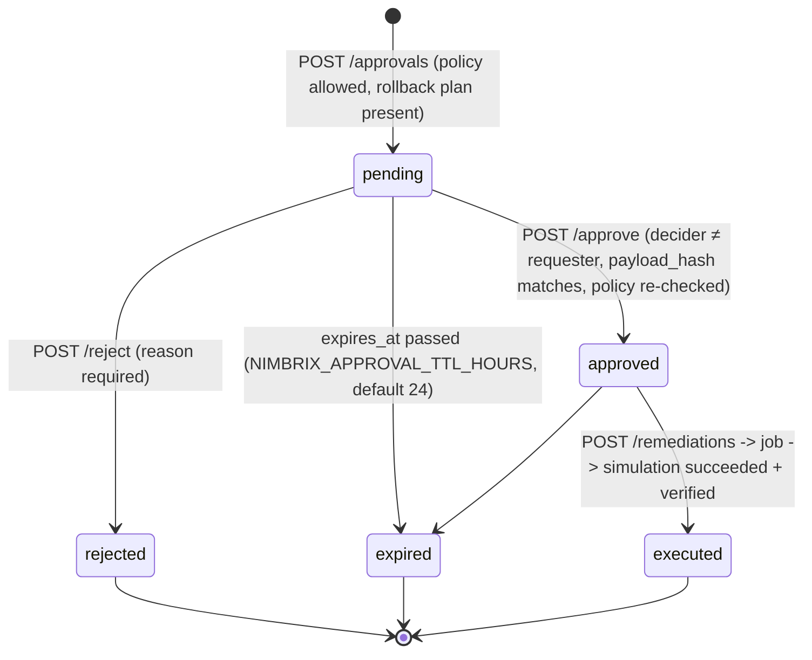

# Approvals and Safe Remediation

Policy: [ADR-0005](adr/0005-safety-policy.md). Code: `apps/api/src/nimbrix_api/modules/remediation/`.

## Action registry

| Action | Mode | Target | Effect |
| --- | --- | --- | --- |
| `simulate_stop_nonprod_instance` | simulation | one running non-production EC2 instance | Records a simulated `stopped` state in `simulated_resource_states`. **No cloud API is called.** Observed inventory is never modified. |

`GET /actions` lists the registry. Any other `action_type` is denied. Setting
`NIMBRIX_LIVE_ACTIONS_ENABLED=true` is rejected at startup, and execution re-checks it.

## Policy checks (evaluated at request, approval, and immediately before execution)

`action_registered` · `payload_schema` (strict, no extra fields) · `resource_in_tenant` ·
`account_region_match` · `resource_type` · `environment_nonprod` · `not_protected`
(`nimbrix:protected=true` blocks) · `state_running` · `inventory_fresh`
(`NIMBRIX_INVENTORY_MAX_AGE_HOURS`, default 48) · `simulation_only`.

## State machine

Execution: `pending → running → succeeded | failed`, recorded in `remediation_executions`
with `before`/`after` state and monthly compute cost, verification result, rollback plan,
attempts, and `realized: false`, `cloud_api_called: false`.

## Integrity controls

| Threat | Control | Test |
| --- | --- | --- |
| Unauthorized approval | `approvals:decide` permission (approver/admin only) | `test_unauthorized_and_self_approval_are_denied` |
| Self-approval | `NIMBRIX_REQUIRE_DISTINCT_APPROVER=true` (default) | same |
| Approving something other than what was reviewed | Approver must send the `payload_hash` they reviewed; SHA-256 over tenant + action + canonical payload | `test_tampered_payload_is_rejected` |
| Payload altered in storage | Hash recomputed at approval and execution | same |
| Stale approvals | Expiry checked on decide/execute; list/get expire lazily | `test_expired_approval` |
| Double execution / replay | `Idempotency-Key` replay; unique `approval_request_id` on executions | `test_duplicate_execution_is_prevented` |
| Stale cloud state | Policy (incl. freshness and running state) re-evaluated right before execution | `test_stale_inventory_blocks_execution`, `test_state_change_after_request_blocks_approval` |
| Missing rollback | Requests without a rollback plan are refused | `test_missing_rollback_plan_is_refused` |
| Worker crash | Job lease expiry → retry; executions are resumable and the adapter is idempotent | `test_worker_crash_and_retry_executes_once` |
| Agents acting | Agents can only evaluate policy read-only; they cannot create or approve requests | `test_policy_review_is_read_only_and_honest` |

Every transition (requested, denied_by_policy, approved, rejected, expired,
self_approval_denied, integrity_failure, remediation.requested/blocked/succeeded/failed) writes
an append-only audit event.

## A real AWS action (not implemented, not enabled)

A future `stop_nonprod_instance` would require, before any code is enabled:

1. A separate feature flag per action, off by default, plus the global
   `NIMBRIX_LIVE_ACTIONS_ENABLED` (which today is rejected at startup).
2. A dedicated IAM role allowing only `ec2:StopInstances` and `ec2:DescribeInstances`, with a
   condition on the resource tag `environment` ∈ {dev, staging} and denying `nimbrix:protected=true`.
3. A per-tenant resource allowlist checked by policy.
4. A `DryRun=True` call first, then the real call, then post-action verification via
   `DescribeInstances` (state `stopping`/`stopped`) and a recorded rollback (`StartInstances`).
5. Blast radius: one instance per approval; EBS data persists; instance-store data is lost;
   dependent services (load balancers, ASGs) may replace or alert on the stopped instance.
6. Explicit owner approval to enable, documented in a new ADR.
